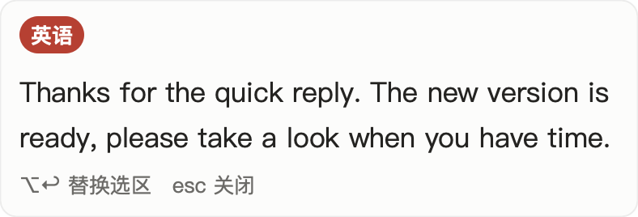
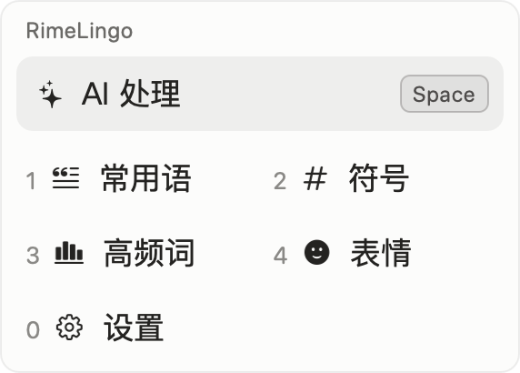
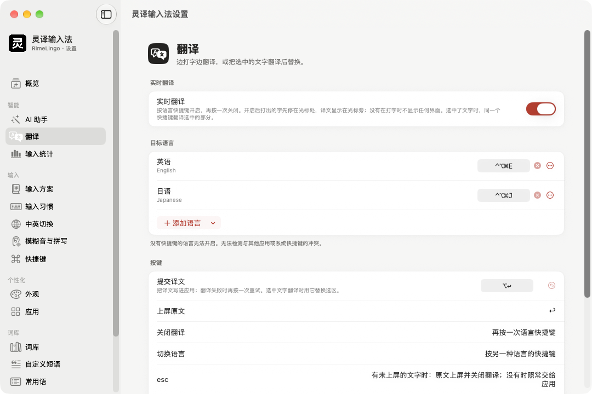

# RimeLingo

[中文](README.md) · [Website](https://rimelingo.keworks.dev/en/)

RimeLingo (灵译输入法) is a Chinese input method for macOS. It is based on the open-source input method [AIME](https://github.com/zoolapp/aime) and uses the [RIME](https://rime.im) engine. Besides everyday pinyin input, it translates what you type into English, Japanese and many other languages as you go and inserts the translation once you confirm it. It can also translate text you have selected in an input field.

## A quick look

<picture>
  <source media="(prefers-color-scheme: dark)" srcset="screenshots/translation-live-en-dark.png">
  
</picture>

Translate as you type: write Chinese as usual, the translation follows next to the cursor, and ⌥↩ inserts it.

<picture>
  <source media="(prefers-color-scheme: dark)" srcset="screenshots/translation-selection-dark.png">
  
</picture>

Translate selected text: select a passage in a chat field or document, press the language shortcut, then ⌥↩ to replace it.

<picture>
  <source media="(prefers-color-scheme: dark)" srcset="screenshots/panel-quick-menu-dark.png">
  
</picture>

The quick menu keeps AI actions, phrases, symbols and emoji in one place.

<picture>
  <source media="(prefers-color-scheme: dark)" srcset="screenshots/settings-translation-dark.png">
  
</picture>

The 翻译 (Translation) page of the settings: pick target languages and give each one a shortcut.

More screenshots are in the [screenshots](screenshots/) folder. The app's interface is in Chinese.

## Requirements

- macOS 15 or later
- A Mac with Apple silicon
- On-device translation needs Apple Intelligence turned on. You can use your own online translation service instead (see "Configuration").

## Installation

1. Download `RimeLingo-<version>.dmg` from the [Releases](https://github.com/leaker/rime-lingo/releases/latest) page.
2. Double-click the downloaded file to open it, then double-click the app inside. It is shown as "RimeLingo" when English is among the system's preferred languages and Simplified Chinese is not ahead of it, and as "灵译输入法" otherwise (also when neither language is in the list); the disk image itself is named "灵译输入法" in every language. When macOS asks whether to open an app downloaded from the internet, click "Open".
3. Click "安装" (Install) in the window that appears.

Then pick "RimeLingo" (or "灵译输入法", by the same rule) from the input menu in the menu bar, or press ⌃Space, and start typing.

The installer copies the input method into your own Input Methods folder (`~/Library/Input Methods`) and enables it. It needs no administrator password and no logout. Afterwards you can eject the disk image and delete the downloaded file.

Later versions download and install themselves while the Mac is idle. You do not repeat these steps. To switch to a particular version by hand, download it and do the same; the button then reads "更新" (Update) or "重新安装" (Reinstall).

<a id="manual-install"></a>

<details>
<summary>Manual installation</summary>

For when the installer window reports an error, or you prefer to do it yourself. First read what the installer said (its messages are in Chinese):

- It contains "文件已复制" (the files were copied) or "已安装并启用" (installed and enabled): the app is already in the Input Methods folder. **Skip step 1 and start at step 2.**
- It contains "已恢复为原来的版本" (the previous version was restored): the previous version still works. Click "重试" (Retry), or start at step 1 to put the new version in by hand.
- It says the package is incomplete or damaged ("不完整或已损坏"): download it again; do not copy this one by hand.

Every step can be repeated.

1. Copy `RimeLingo.app` from the disk image to `~/Library/Input Methods/` (in Finder press ⇧⌘G and paste that path); choose "Replace" if Finder asks. `RimeLingo-<version>.zip` unzips to the same app.
2. Open Terminal and run:

   ```bash
   xattr -dr com.apple.quarantine ~/Library/Input\ Methods/RimeLingo.app
   ~/Library/Input\ Methods/RimeLingo.app/Contents/MacOS/RimeLingo --install
   killall imklaunchagent TextInputMenuAgent TextInputSwitcher
   ```

   The last line restarts the system processes that launch input methods; they come back by themselves, and a message that no process was found can be ignored. Logging out and back in does the same if you would rather not run it. If step 1 replaced a version that was already installed, log out and back in once after this step as well.
3. If "RimeLingo" (shown as "灵译输入法" unless English is among the system's preferred languages with Simplified Chinese not ahead of it) is not in the input menu of the menu bar yet, open System Settings › Keyboard › Input Sources › Edit…, click "+", and add it under "Chinese, Simplified".

</details>

## Usage

### Ordinary input

It works like other pinyin input methods: type pinyin, pick a candidate with Space or a number key. Press Shift to switch between Chinese and English.

### Translate as you type

1. In any input field press **⌃⌥⌘E** (to English) or **⌃⌥⌘J** (to Japanese) to turn live translation on. A hint next to the cursor shows the target language and the keys once.
2. Type Chinese as usual. The translation appears next to the cursor and follows your input. Nothing is shown while you are not typing.
3. Press **⌥↩** to insert the translation; if the translation failed, press **⌥↩** again to retry. Press **↩** to insert the Chinese text instead.
4. Live translation stays on, also when you move to another input field. Press the same shortcut again to turn it off, or the shortcut of another language to switch the target. In applications set to start in English (terminals, editors, launchers) and in password managers it does not resume on its own: press the language shortcut there if you want it.

Until you insert the translation you can keep editing the Chinese text: move the cursor with the arrow keys, insert or delete, and the translation updates. When you turn translation off, Chinese text that has not been inserted yet is written to the input field first, so nothing is lost.

The translation view has no buttons; everything is done from the keyboard. English and Japanese are enabled by default. On the 翻译 (Translation) page of the settings you can add other languages and give each its own shortcut.

### Translate selected text

Select text where you can type (a chat field, a document, an editor) and press **⌃⌥⌘E** or **⌃⌥⌘J** (or the shortcut you gave another language). When the translation appears, press **⌥↩** to replace the selection with it, **⌥↩** again to retry after a failure, or **Esc** to close it.

Selections in read-only content (web page text, PDFs) are not supported.

### Password fields

In password fields RimeLingo does nothing: key presses go straight to the system, no candidate window appears and no translation starts.

## Configuration

Click the input method icon in the menu bar and choose "灵译输入法设置…" (RimeLingo Settings). The settings app is in Chinese. The most used sections:

| Section | What it does |
| --- | --- |
| 翻译 (Translation) | Turn live translation on or off; add, remove and reorder target languages; give each language a shortcut; change the "insert translation" shortcut; choose the translation service |
| AI 助手 (AI assistant) | Configure the translation service: the on-device model, or any online service with an OpenAI-compatible API (enter its address and key) |
| 输入方案 (Schemas) | Full pinyin, double pinyin and other schemas |
| 输入习惯, 中英切换, 模糊音与拼写 | Number of candidates, switching keys, fuzzy pinyin |
| 外观 (Appearance) | Colours, fonts, horizontal or vertical candidates |
| 词库, 自定义短语, 常用语 | Add dictionaries and your own phrases |
| 应用 (Applications) | Set the default Chinese or English state per application |

### Migrating from Squirrel

On the "概览" (Overview) page click "导入" (Import) to bring over your Squirrel schemas and custom configuration. Importing does not change `~/Library/Rime`.

### Where data is kept

- Configuration and dictionaries: `~/Library/RimeLingo/Rime`
- Logs: `~/Library/Logs/RimeLingo`

## Privacy

- With the on-device model, text does not leave your Mac.
- Text is sent out only if you configure an online service under "AI 助手", and only to the address you entered.
- Input statistics are off by default and stay on your Mac when turned on.

## Updates and removal

- **Updates**: RimeLingo checks for a new version once a day, verifies its signature and installs it while the Mac is idle. You can turn this off on the "概览" (Overview) page.
- **Removal**: remove 灵译输入法 in System Settings › Keyboard › Input Sources, then delete `~/Library/Input Methods/RimeLingo.app`. To remove your data as well, delete `~/Library/RimeLingo`.

## License

See [LICENSE](LICENSE).

## Acknowledgements

RimeLingo is based on [AIME](https://github.com/zoolapp/aime) (© 2026 ZOOL LLC, MIT License); the settings app and most of the input method's basic features come from that project. The input engine is [RIME](https://rime.im). Thanks to the authors and contributors of both.
