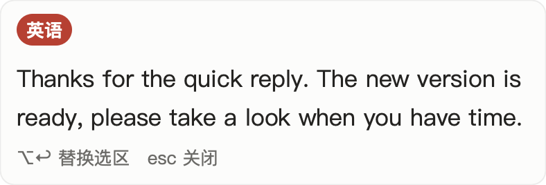
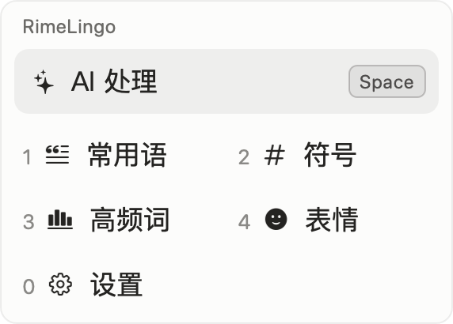
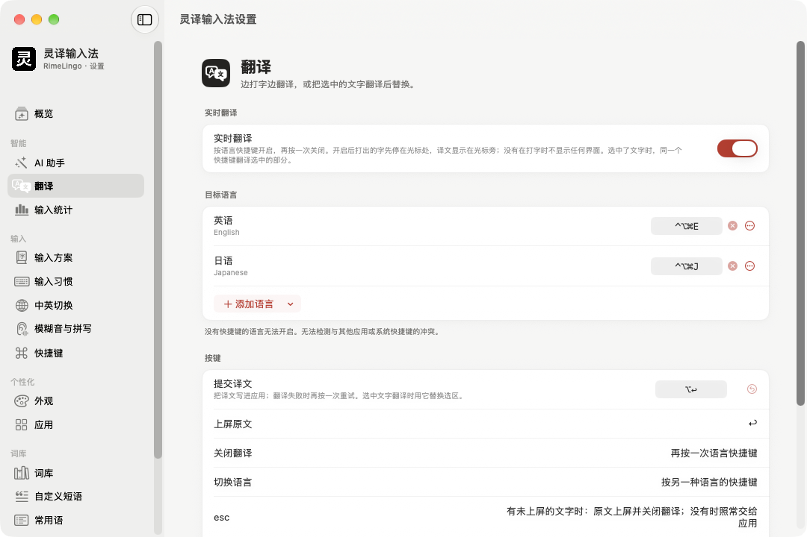

# 灵译输入法

[English](README.en.md) · [产品网站](https://rimelingo.keworks.dev)

灵译输入法（RimeLingo）是一款 macOS 中文输入法，基于开源输入法 [AIME](https://github.com/zoolapp/aime) 开发，输入引擎为 [RIME](https://rime.im)。除了日常的拼音输入，它还能在你打字的同时把中文译成英语、日语等多种语言，确认后再上屏；也能翻译输入框里选中的文字。

## 看一看

<picture>
  <source media="(prefers-color-scheme: dark)" srcset="screenshots/translation-live-en-dark.png">
  
</picture>

边打边译：照常输入中文，译文显示在光标旁，按 ⌥↩ 写入输入框。

<picture>
  <source media="(prefers-color-scheme: dark)" srcset="screenshots/translation-selection-dark.png">
  
</picture>

翻译选中的文字：在聊天框或文档里选中一段，按语言快捷键，再按 ⌥↩ 替换。

<picture>
  <source media="(prefers-color-scheme: dark)" srcset="screenshots/panel-quick-menu-dark.png">
  
</picture>

快捷菜单：AI 处理、常用语、符号和表情都在一处。

<picture>
  <source media="(prefers-color-scheme: dark)" srcset="screenshots/settings-translation-dark.png">
  
</picture>

设置里的「翻译」页：选择目标语言，给每种语言设一个快捷键。

更多截图见 [screenshots](screenshots/) 文件夹。

## 系统要求

- macOS 15 或更新版本
- Apple 芯片的 Mac
- 使用本机翻译需要系统已开启 Apple 智能；也可以改用你自己的在线翻译服务（见「配置」）

## 安装

1. 在 [Releases](https://github.com/leaker/rime-lingo/releases/latest) 页面下载 `RimeLingo-<版本>.dmg`。
2. 双击打开下载的文件，再双击里面的「灵译输入法」。如果系统的首选语言里有英文，并且简体中文没有排在它前面，这个名字会显示为 RimeLingo，下文同。系统询问是否打开从互联网下载的应用时，点「打开」。
3. 在弹出的窗口里点「安装」。

装好后，点菜单栏的输入法图标选择「灵译输入法」（或 RimeLingo），或者按 ⌃空格 切换，就可以开始打字了。

安装程序会把输入法复制到你个人的「输入法」文件夹（`~/Library/Input Methods`）并启用，不需要管理员密码，也不用注销。完成后可以推出磁盘映像，并删除下载的文件。

之后的新版本会自动下载并在空闲时安装，不需要重复以上步骤。想手动换成某个版本时，下载它并照同样的步骤做，窗口里的按钮会变成「更新」或「重新安装」。

<a id="manual-install"></a>

<details>
<summary>手动安装</summary>

安装窗口报错，或者想自己动手时用。先看安装窗口的提示：

- 提示里有「文件已复制」或「已安装并启用」：应用已经在「输入法」文件夹里，**跳过第 1 步，从第 2 步开始**。
- 提示里有「已恢复为原来的版本」：原来的版本照常可用。可以点「重试」；要手动换成新版本，从第 1 步开始。
- 提示安装包不完整或已损坏：重新下载，不要手动拷贝这一份。

每一步都可以重复做。

1. 把磁盘映像里的 `RimeLingo.app` 拷贝到 `~/Library/Input Methods/`（在访达里按 ⇧⌘G，粘贴这个路径），访达询问时选「替换」。也可以下载 `RimeLingo-<版本>.zip`，解压后得到同一个应用。
2. 打开「终端」，运行：

   ```bash
   xattr -dr com.apple.quarantine ~/Library/Input\ Methods/RimeLingo.app
   ~/Library/Input\ Methods/RimeLingo.app/Contents/MacOS/RimeLingo --install
   killall imklaunchagent TextInputMenuAgent TextInputSwitcher
   ```

   最后一行重启系统里负责启动输入法的几个进程，它们会自动恢复；提示找不到进程可以忽略。不想运行它的话，注销后重新登录一次，效果相同。如果第 1 步替换了已有的版本，做完这一步后也请注销并重新登录一次。
3. 如果菜单栏的输入法列表里还没有「灵译输入法」（系统的首选语言里有英文、且简体中文没有排在它前面时叫 RimeLingo），到「系统设置 › 键盘 › 输入法 › 编辑…」，点「+」，在「简体中文」里添加它。

</details>

## 使用

### 普通输入

和其他拼音输入法一样：打拼音，空格或数字键选字。按 Shift 在中文和英文之间切换。

### 边打边译

1. 在任意输入框里按 **⌃⌥⌘E**（译成英语）或 **⌃⌥⌘J**（译成日语）开启实时翻译。光标旁会提示一次当前的目标语言和按键。
2. 照常输入中文。译文显示在光标旁，随你的输入更新。没有在打字时不显示任何界面。
3. 按 **⌥↩** 把译文写入输入框；翻译失败时再按一次 **⌥↩** 重试。按 **↩** 则写入中文原文。
4. 实时翻译会一直开着，换一个输入框也不用重新开启。再按一次同一个快捷键关闭；按另一种语言的快捷键切换目标语言。在设为默认英文的应用（终端、编辑器、启动器）和密码管理器里不会自动接着翻译，需要时在那里按一次语言快捷键。

在译文上屏之前，你可以继续修改中文：用方向键移动光标，插入或删除内容，译文会跟着更新。关闭翻译时，还没上屏的中文会先写入输入框，不会丢失。

译文界面里没有按钮，全部用键盘操作。英语和日语是默认启用的两种语言；在设置的「翻译」页可以添加其他语言，并给每种语言设置自己的快捷键。

译文会保持原文的语气：朋友间的口语译成口语（例如日语用简体、英语用缩略形式），工作邮件等正式内容译成礼貌用语。

译文默认会顺带润色：读起来更自然通顺，原文里的错别字和标点也会一并修正。润色和翻译在同一次请求里完成，不会多等。想要按原文直译，在设置的「翻译」页关闭「翻译时同时润色」。边打边译和翻译选中的文字都遵循这个开关。

### 翻译选中的文字

在可以输入的地方（聊天框、文档、编辑器）选中一段文字，按 **⌃⌥⌘E** 或 **⌃⌥⌘J**（或你给其他语言设置的快捷键）。译文出现后，按 **⌥↩** 用它替换选中的文字，翻译失败时按 **⌥↩** 重试，按 **Esc** 关闭。

只读内容（网页正文、PDF）里的选中文字不在支持范围内。

### 密码框

在密码框里，灵译输入法不做任何处理，按键原样交给系统，不会出现候选窗，也不会触发翻译。

## 配置

点菜单栏的输入法图标，选「灵译输入法设置…」。常用的几项：

| 位置 | 能做什么 |
| --- | --- |
| 翻译 | 开关实时翻译；开关「翻译时同时润色」（默认开启，关闭后直译）；添加、移除目标语言并调整顺序；给每种语言设置快捷键；修改「提交译文」的快捷键；选择翻译服务 |
| AI 助手 | 配置翻译服务：本机模型，或任何兼容 OpenAI 接口的在线服务（填入地址和密钥，并允许把文字发送给它） |
| 输入方案 | 全拼、双拼等方案的选择 |
| 输入习惯、中英切换、模糊音与拼写 | 候选数量、切换键、模糊音等 |
| 外观 | 配色、字体、横排或竖排 |
| 词库、自定义短语、常用语 | 添加词库和自己的短语 |
| 应用 | 为某个应用指定默认的中英文状态 |

### 从鼠须管迁移

在设置的「概览」页点「导入」，可以把鼠须管的方案和自定义配置带过来。导入不会修改 `~/Library/Rime`。

### 数据位置

- 配置和词库：`~/Library/RimeLingo/Rime`
- 日志：`~/Library/Logs/RimeLingo`

## 隐私

- 使用本机模型时，文字不离开你的 Mac。
- 只有当你在「AI 助手」里配置了在线服务，待翻译的文字才会发送到你填写的那个地址。
- 输入统计默认关闭，开启后也只保存在本机。

## 更新与卸载

- **更新**：每天检查一次新版本，校验签名后在空闲时自动安装。可以在设置的「概览」页关闭。
- **卸载**：在「系统设置 › 键盘 › 输入法」里移除灵译输入法，再删除 `~/Library/Input Methods/RimeLingo.app`。需要连同数据一起清除时，再删除 `~/Library/RimeLingo`。

## 常见问题

**某个应用里，菜单栏的灵译输入法是灰色的、选了没有反应，或者一切到这个应用就变回 ABC 或别的输入法**

这个应用在安装灵译之前就已经开着，还记着安装前的输入法列表。把这个应用完全退出（⌘Q）再打开即可。用 Safari「添加到程序坞」做成的网页应用，要把这类网页应用全部退出再打开。

如果很多应用都这样，注销后重新登录一次，或者重启电脑，所有应用都会恢复正常。

**「系统设置 › 键盘 › 输入法」的列表里，灵译输入法那一行没有名字或图标，添加不了**

完全退出「系统设置」（⌘Q）再打开。还是不行就注销后重新登录一次。

**能选中灵译输入法，但打不出字**

在终端运行下面这行，或者注销后重新登录一次：

```bash
killall imklaunchagent TextInputMenuAgent TextInputSwitcher
```

## 许可

见 [LICENSE](LICENSE)。

## 致谢

灵译输入法基于 [AIME](https://github.com/zoolapp/aime)（© 2026 ZOOL LLC，MIT 许可）开发，设置应用和输入法的大部分基础功能来自该项目。输入引擎是 [RIME](https://rime.im)。感谢这两个项目的作者和贡献者。
